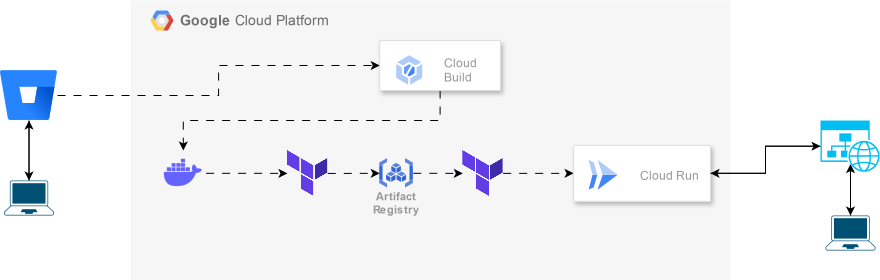
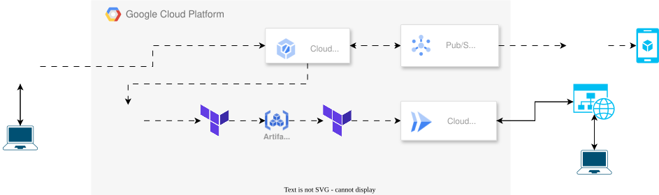

# Cloud Build + Terraform CI/CD for Cloud Run (Bitbucket source)

A complete, security-minded CI/CD reference on Google Cloud: every push to a
Bitbucket repository triggers **Cloud Build**, which builds a container image,
pushes it to **Artifact Registry** and deploys it to **Cloud Run** with
**Terraform** (remote state in GCS). All supporting infrastructure is
provisioned with Terraform, no long-lived service account keys are used, and
an optional Cloud Run function posts build status notifications to
**Telegram**.

## Architecture



Editable source: [`docs/architecture.drawio`](docs/architecture.drawio).

| Component | Role |
|---|---|
| Bitbucket Cloud | Source repository. Connected to Cloud Build (2nd gen) through a connection scoped to this single repository. |
| Cloud Build | Runs [`cloudbuild.yaml`](cloudbuild.yaml) on push, as a dedicated least-privilege service account. |
| Artifact Registry | Private Docker repository. Images are tagged with the immutable commit SHA; a cleanup policy bounds storage. |
| Cloud Run | Serves the container (`google_cloud_run_v2_service`), private by default, scales to zero. |
| Cloud Storage | Terraform remote state (versioned, uniform bucket-level access, public access prevention). |
| Terraform | Two layers: `bootstrap` (one-time foundations) and `service` (deployed on every build). |
| Pub/Sub + Cloud Run function (optional) | Listens to the `cloud-builds` topic and sends build notifications to Telegram. |

## Repository layout

```text
.
├── cloudbuild.yaml              # CI/CD pipeline (build, push, terraform plan/apply)
├── Dockerfile                   # nginx-unprivileged image (non-root, port 8080)
├── nginx.conf                   # /health endpoint and security headers
├── index.html                   # Demo page
├── terraform/
│   ├── bootstrap/               # APIs, Artifact Registry, service accounts, IAM (run once)
│   └── service/                 # Cloud Run service (applied by the pipeline)
├── functions/
│   └── telegram-notifier/       # Optional Cloud Build -> Telegram notifier (Python 3.12)
├── docs/                        # Diagrams (SVG + editable draw.io sources)
└── .github/workflows/ci.yml     # Static checks and unit tests
```

## Pipeline stages

Defined in [`cloudbuild.yaml`](cloudbuild.yaml). The image URI is
`${_REGION}-docker.pkg.dev/$PROJECT_ID/${_AR_REPOSITORY}/${_SERVICE_NAME}:$SHORT_SHA`.

| Step id | Image | What it does |
|---|---|---|
| `check-substitutions` | `bash` | Fails fast if `_TF_STATE_BUCKET` or `_RUNTIME_SA` is not set on the trigger. |
| `docker-build` | `gcr.io/cloud-builders/docker` | Builds the image, tagged with the commit SHA. |
| `docker-push` | `gcr.io/cloud-builders/docker` | Pushes the image explicitly, so it exists in Artifact Registry before Terraform references it. |
| `terraform-init` | `hashicorp/terraform:1.13.5` | Initializes `terraform/service` with the GCS backend (`prefix=service`). |
| `terraform-plan` | `hashicorp/terraform:1.13.5` | Creates a saved plan (`-out=tfplan`) for the new image. |
| `terraform-apply` | `hashicorp/terraform:1.13.5` | Applies exactly that saved plan (`apply tfplan`). |

**Why `plan -out` + `apply tfplan`:** the apply executes the reviewed plan
byte for byte, with no second, implicit re-plan between the two steps and no
`-auto-approve`. If the state changes in between, Terraform refuses the stale
plan instead of applying something nobody looked at. It also leaves a clear
plan log in every build.

The build uses `options.logging: CLOUD_LOGGING_ONLY`, which is required when a
trigger runs as a user-managed service account.

## Why two Terraform layers

The deployment has a chicken-and-egg ordering problem: the Artifact Registry
repository must exist **before** the image can be pushed, and the image must
exist **before** Cloud Run can be deployed. Putting everything in one root
module would force either `terraform apply -target=...` (an escape hatch, not
a workflow) or a deploy that fails on the first run.

| Layer | Path | Applied by | Manages |
|---|---|---|---|
| bootstrap | [`terraform/bootstrap`](terraform/bootstrap) | An operator, once (ADC credentials) | Required APIs (Run, Artifact Registry, Cloud Build, IAM, Cloud Resource Manager), the Artifact Registry repository, the build and runtime service accounts and their IAM bindings. |
| service | [`terraform/service`](terraform/service) | Cloud Build, on every push | The Cloud Run service and, only when enabled, the public invoker binding. |

Both layers use the `hashicorp/google` provider `~> 8.0` (locked to 8.12.0),
Terraform `>= 1.6`, and the same GCS bucket with different state prefixes
(`bootstrap` and `service`). The state bucket itself is created with `gcloud`
(see below), because a backend cannot be provisioned by the configuration that
uses it.

## Security decisions

- **No service account JSON keys.** Terraform runs locally with Application
  Default Credentials (`gcloud auth application-default login`); in Cloud Build
  it runs as a user-managed build service account. No key file is ever created
  or stored.
- **Least-privilege build service account** (`cloudbuild-deployer` by default).
  Each role is bound at the narrowest scope that works:

  | Role | Scope | Why |
  |---|---|---|
  | `roles/run.admin` | Project | Create and update the Cloud Run service and its IAM policy. |
  | `roles/logging.logWriter` | Project | Write build logs (`CLOUD_LOGGING_ONLY`). |
  | `roles/artifactregistry.writer` | The Artifact Registry repository only | Push images. |
  | `roles/iam.serviceAccountUser` | The runtime service account only | Deploy Cloud Run as that identity. |
  | `roles/storage.objectUser` | The Terraform state bucket only | Read and write state. |

  The runtime service account (`cloudrun-runtime` by default) has **no roles**;
  grant it only what the application actually needs.
- **Remote state in GCS** with object versioning (recover from a bad write),
  uniform bucket-level access (IAM only, no ACLs) and public access prevention.
- **Hardened container.** Based on `nginxinc/nginx-unprivileged:1.28.1-alpine`,
  running as UID 101 on port 8080, with `server_tokens off` and the headers
  `X-Content-Type-Options: nosniff`, `X-Frame-Options: DENY` and
  `Referrer-Policy: no-referrer`. `/health` returns `200` and backs the Cloud
  Run startup probe (not `/healthz`: URL paths ending in "z" are reserved by
  Cloud Run's frontend).
- **Repository-scoped Bitbucket access.** The Cloud Build connection is limited
  to this one repository rather than the whole workspace. The Telegram notifier
  reads commit messages with a Bitbucket **repository access token** (Bitbucket
  app passwords were retired in 2026).
- **Private by default.** `allow_unauthenticated` defaults to `false`, so the
  service requires an authenticated caller with `roles/run.invoker`. For a
  public demo, set the trigger substitution `_ALLOW_UNAUTHENTICATED=true`; the
  `service` layer then adds the `allUsers` invoker binding. Setting it back to
  `false` removes the binding on the next build.
- **Secrets in Secret Manager.** Tokens (Telegram bot token, Bitbucket access
  token) are injected from Secret Manager, never committed or passed as plain
  build substitutions.

## Getting started

### Prerequisites

- A Google Cloud project with billing enabled, and permission to enable APIs
  and manage IAM in it.
- `gcloud` CLI and Terraform `>= 1.6`.
- A Bitbucket Cloud repository containing this code.

The examples use `my-gcp-project` and `my-tf-state-bucket`; replace them with
your own values.

### 1. Create the Terraform state bucket

```bash
gcloud storage buckets create gs://my-tf-state-bucket \
  --project=my-gcp-project \
  --location=us-central1 \
  --uniform-bucket-level-access \
  --public-access-prevention

gcloud storage buckets update gs://my-tf-state-bucket --versioning
```

### 2. Apply the bootstrap layer

```bash
# Step 0: Terraform needs these two APIs active before it can enable the rest.
gcloud services enable serviceusage.googleapis.com cloudresourcemanager.googleapis.com \
  --project=my-gcp-project

gcloud auth application-default login

cp terraform/bootstrap/terraform.tfvars.example terraform/bootstrap/terraform.tfvars
# edit project_id and tf_state_bucket

terraform -chdir=terraform/bootstrap init \
  -backend-config="bucket=my-tf-state-bucket" \
  -backend-config="prefix=bootstrap"

terraform -chdir=terraform/bootstrap plan -out=tfplan && \
  terraform -chdir=terraform/bootstrap apply tfplan

terraform -chdir=terraform/bootstrap output
```

| Variable | Default | Description |
|---|---|---|
| `project_id` | required | Target project. |
| `tf_state_bucket` | required | Existing state bucket (the build SA gets access to it). |
| `region` | `us-central1` | Region for Artifact Registry. |
| `repository_id` | `cloudbuild-demo` | Artifact Registry repository ID. |
| `build_service_account_id` | `cloudbuild-deployer` | Build service account ID. |
| `runtime_service_account_id` | `cloudrun-runtime` | Cloud Run runtime service account ID. |

Outputs: `artifact_registry_repository_url`, `build_service_account_email`,
`runtime_service_account_email`.

### 3. Connect Bitbucket and create the trigger

1. In Cloud Build, create a **2nd gen** host connection to Bitbucket Cloud and
   link **only this repository**.
2. Create a push trigger on that repository with:
   - Configuration: `cloudbuild.yaml` (Cloud Build configuration file).
   - Service account: the `build_service_account_email` output.
   - Substitutions:

| Substitution | Required | Default | Description |
|---|---|---|---|
| `_TF_STATE_BUCKET` | yes | (empty) | Terraform state bucket name. |
| `_RUNTIME_SA` | yes | (empty) | The `runtime_service_account_email` output. |
| `_REGION` | no | `us-central1` | Region for Artifact Registry and Cloud Run. |
| `_AR_REPOSITORY` | no | `cloudbuild-demo` | Must match the bootstrap `repository_id`. |
| `_SERVICE_NAME` | no | `cloudbuild-demo` | Cloud Run service name (also the image name). |
| `_ALLOW_UNAUTHENTICATED` | no | `false` | `true` makes the service publicly invokable. |

### 4. Push and verify

Push a commit to the tracked branch, then:

```bash
gcloud run services describe cloudbuild-demo \
  --project=my-gcp-project --region=us-central1 \
  --format='value(status.url)'

URL=$(gcloud run services describe cloudbuild-demo \
  --project=my-gcp-project --region=us-central1 \
  --format='value(status.url)')

# Private service (default): call it with an identity token
curl -H "Authorization: Bearer $(gcloud auth print-identity-token)" "$URL/health"

# Public service (_ALLOW_UNAUTHENTICATED=true)
curl "$URL/health"
```

The caller of the private variant needs `roles/run.invoker` on the service.

## Cost notes

- Cloud Run uses `min_instance_count = 0`, so the service scales to zero when
  idle (`max_instance_count = 2` caps spend under load).
- The Artifact Registry cleanup policy keeps the 10 most recent versions and
  deletes untagged images older than 7 days.
- Cloud Build includes a daily allowance of free build minutes, which covers a
  demo like this one.
- There are no always-on resources: no VMs, clusters, load balancers or NAT.

## Telegram notifications (optional)



A Python 3.12 Cloud Run function (2nd gen) subscribes to the `cloud-builds`
Pub/Sub topic and posts build status, trigger name, commit message and a link
to the logs to a Telegram chat. Configuration, deployment and tests are
documented in [`functions/telegram-notifier/README.md`](functions/telegram-notifier/README.md).
Editable diagram source: [`docs/telegram-notifier.drawio`](docs/telegram-notifier.drawio).

## CI

A GitHub Actions workflow ([`.github/workflows/ci.yml`](.github/workflows/ci.yml))
runs static checks and tests on the repository: `terraform fmt`,
`terraform validate`, TFLint, Checkov, Hadolint and the notifier unit tests.

## Demo video

[Watch the walkthrough on YouTube](https://youtu.be/kLS2vdNE6zQ). Note that
the video shows the **first version** of this pipeline; the repository has
since been reworked (split Terraform layers, least-privilege build service
account, saved-plan apply, hardened container), so some details differ.

## Limitations and next steps

- The Bitbucket connection and trigger are created manually; they could be
  managed in Terraform with the `google_cloudbuildv2_*` and
  `google_cloudbuild_trigger` resources.
- Running Terraform from GitHub Actions (for example, plan on pull requests)
  would use Workload Identity Federation instead of keys.
- A single environment is deployed; staging and production would use separate
  projects or state prefixes with promotion between them.
- Binary Authorization could enforce that only images built by this pipeline
  are deployed.
- Canary releases could use Cloud Run traffic splitting between revisions.

## License

[MIT](LICENSE)
