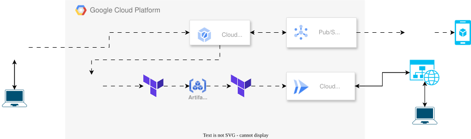

# Cloud Build -> Telegram notifier

A Cloud Run function (2nd gen) that subscribes to the `cloud-builds` Pub/Sub
topic and posts Cloud Build status changes to a Telegram chat. Each message
includes the build status, the trigger name, the first line of the commit
message (fetched from Bitbucket Cloud), the short commit SHA and a link to the
build logs.



## Behavior

| Cloud Build status | Notification |
|---|---|
| `QUEUED`, `WORKING` | "running" |
| `SUCCESS`, `FAILURE`, `TIMEOUT`, `CANCELLED`, `INTERNAL_ERROR` | final status |
| anything else | ignored |

- If `TARGET_TRIGGER_NAMES` is empty, every trigger is reported.
- If the Bitbucket token is not configured or the API call fails, the message
  falls back to `commit message unavailable`; the notification is still sent.
- Missing required configuration is logged and the invocation returns without
  raising. Secrets and the Telegram API URL (which embeds the bot token) are
  never logged.

## Environment variables

| Variable | Required | Description |
|---|---|---|
| `TELEGRAM_BOT_TOKEN` | yes | Bot token from @BotFather (store in Secret Manager). |
| `TELEGRAM_CHAT_ID` | yes | Target chat, group or channel ID. |
| `BITBUCKET_ACCESS_TOKEN` | no | Bitbucket repository access token (store in Secret Manager). |
| `BITBUCKET_WORKSPACE` | no | Bitbucket workspace ID. |
| `BITBUCKET_REPO_SLUG` | no | Bitbucket repository slug. |
| `TARGET_TRIGGER_NAMES` | no | Comma-separated Cloud Build trigger names; empty = all triggers. |

## Bitbucket repository access token

Bitbucket App Passwords are deprecated and can no longer be created, so this
function authenticates with a **repository access token**
(`Authorization: Bearer <token>`):

1. In Bitbucket, open the repository -> **Repository settings** ->
   **Security** -> **Access tokens** -> **Create access token**.
2. Grant only the **Repositories: Read** scope.
3. Copy the token once and store it in Secret Manager (below).

## Store secrets in Secret Manager

```bash
PROJECT_ID=my-project
printf '%s' 'YOUR_TELEGRAM_BOT_TOKEN' | gcloud secrets create telegram-bot-token \
  --project="$PROJECT_ID" --data-file=-
printf '%s' 'YOUR_BITBUCKET_TOKEN' | gcloud secrets create bitbucket-access-token \
  --project="$PROJECT_ID" --data-file=-
```

Grant the function's runtime service account
`roles/secretmanager.secretAccessor` on both secrets.

## Deploy

The `cloud-builds` topic is created automatically once Cloud Build is enabled.
From this directory:

```bash
gcloud functions deploy telegram-notifier \
  --gen2 \
  --runtime=python312 \
  --region=us-central1 \
  --trigger-topic=cloud-builds \
  --entry-point=cloud_build_pubsub \
  --source=. \
  --set-env-vars=TELEGRAM_CHAT_ID=YOUR_CHAT_ID,BITBUCKET_WORKSPACE=your-workspace,BITBUCKET_REPO_SLUG=your-repo,TARGET_TRIGGER_NAMES=deploy-main \
  --set-secrets=TELEGRAM_BOT_TOKEN=telegram-bot-token:latest,BITBUCKET_ACCESS_TOKEN=bitbucket-access-token:latest
```

To include commas in `TARGET_TRIGGER_NAMES` via `--set-env-vars`, use gcloud's
alternate delimiter syntax (`--set-env-vars=^;^KEY=a,b;OTHER=c`) or an
`--env-vars-file`.

## Run the tests

The tests use only the Python standard library (`unittest` + `unittest.mock`);
third-party modules are stubbed, so nothing needs to be installed. From the
repository root:

```bash
python3 -m unittest discover -s functions/telegram-notifier -v
```
